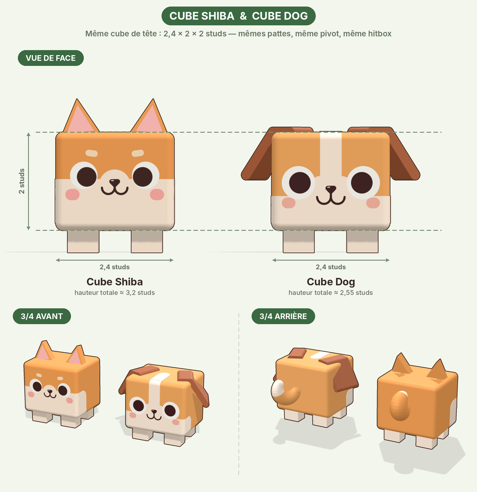
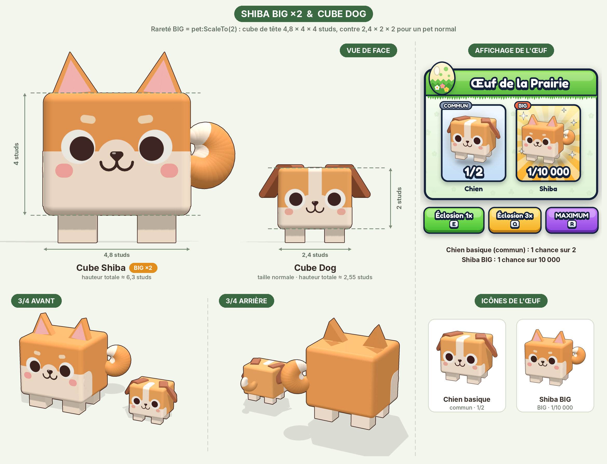
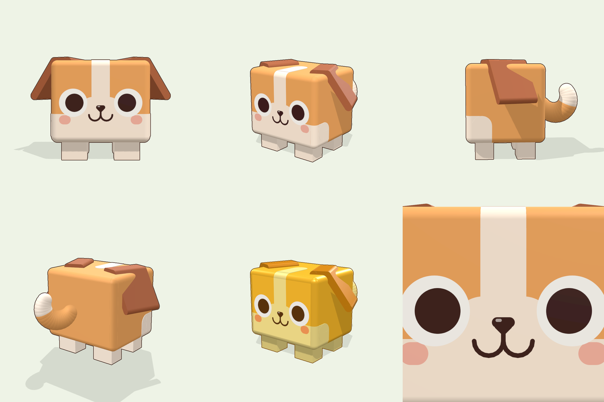

# Cube Pets : pets Roblox (style Pet Simulator)

Deux pets cubiques qui partagent **exactement les mêmes proportions** (corps, pattes, arêtes arrondies). Seuls les oreilles, la queue, le visage et les couleurs changent.



En rareté **BIG**, un pet est simplement agrandi ×2 avec `pet:ScaleTo(2)`, depuis son pivot au sol, donc les pattes restent sur le sol. Son cube de tête passe alors à 4,8 × 4 × 4 studs :



La colonne de droite montre l'affichage de l'œuf « Œuf de la Prairie » : le chien basique (commun) à 1/2 et le Shiba BIG à 1/10 000. L'UI seule est aussi disponible dans `preview/oeuf_prairie.png`.

Les pets sont faits **uniquement de pièces Roblox + une SurfaceGui pour le visage** : aucun mesh ni aucune image à uploader. Tu glisses le fichier dans Studio et c'est prêt.

| Fichier | Contenu |
|---|---|
| `CubeShiba.rbxmx` / `CubeShiba_Golden.rbxmx` | Shiba, version normale et dorée |
| `CubeDog.rbxmx` / `CubeDog_Golden.rbxmx` | Chien, version normale et dorée |
| `src/CubePetBuilder.luau` | Source qui génère les modèles (dimensions, couleurs, visages) |
| `tools/` | Export (Lune), vérifications, viewer 3D web |
| `preview/` | Rendus des modèles (`comparaison.png`, `comparaison_big.png`, `oeuf_prairie.png`, `shiba_*.png`, `chien_*.png`) |

## Importer dans Roblox Studio

1. Glisse le `.rbxmx` dans la fenêtre 3D de Studio, ou fais *clic droit sur ReplicatedStorage → Insert from File…*.
2. Range le modèle où ton système de pets va le chercher, par exemple `ReplicatedStorage/Pets/CubeDog`.

## Les pets

### Cube Shiba


- Pelage orange, ventre et bas du visage crème, bosse crème du museau, sourcils clairs.
- Oreilles triangulaires avec intérieur rose.
- Queue enroulée sur le côté arrière gauche, pointe et intérieur crème.

### Cube Dog


- Pelage fauve.
- Liste blanche qui part du museau, monte sur le front et continue sur le dessus de la tête.
- Museau et bas du visage crème.
- Oreilles tombantes marron : un rabat posé sur la tête et un pan qui pend en biais, avec des plis arrondis.
- Queue relevée en croissant, pointe blanche.

### Commun aux deux
- **Corps** : cube 2,4 × 2 × 2 studs aux arêtes arrondies, taches crème sur le bas des flancs, 4 pattes « blocky » crème.
- **Visage** : SurfaceGui vectorielle posée directement sur la face avant (`Visual/Body/CoreFront/Face`). Elle contient le pelage, les zones crème, les yeux (blanc + pupille noire, sans reflet), la truffe, la bouche « ω » et les joues. L'éclairage est le même que sur le reste du corps, et le rendu reste net à toutes les distances.
- **Contour cartoon** : `Highlight` nommé `Outline` (contour seul), comme les traits noirs des planches.
- **Taille** : environ 3 studs de haut, 74 à 78 pièces.
- Les pets ont seulement le visage neutre : ni expressions, ni poses.

## Structure et rig

```
CubeDog (Model)              PrimaryPart = RootPart, pivot au sol
├─ RootPart                  hitbox invisible, Anchored, CanQuery = true (clics / raycasts)
│  └─ RootJoint (Motor6D)  → Body
├─ Body                      os invisible du corps
│  └─ Motor6D : EarL, EarR, Tail, LegFL, LegFR, LegBL, LegBR
├─ EarL / EarR / Tail        os invisibles
├─ LegFL / LegFR / LegBL / LegBR
├─ Visual/                   toutes les pièces visibles, soudées (Weld) à leur os
│  ├─ Body/  (CoreFront porte la SurfaceGui « Face »)
│  ├─ EarL/  EarR/  Tail/
├─ Outline (Highlight)
└─ AnimationController > Animator
```

- Le pet **regarde vers -Z** (LookVector). Pour l'orienter : `pet:PivotTo(CFrame.lookAt(pos, pos + direction))`.
- Le **pivot est au sol**, sous le corps : `pet:PivotTo(CFrame.new(positionAuSol))` pose les pattes pile sur le sol.
- `L` / `R` = gauche / droite **du pet**.
- Toutes les pièces sont `CanCollide = false`, `CanTouch = false`, `Massless = true` : le pet ne gêne ni la physique ni les joueurs.
- `RootPart` est ancrée, ce qui convient aux systèmes de pets qui déplacent le modèle par `PivotTo` côté client (le cas le plus courant). Si ton système utilise la physique (`AlignPosition`…), désancre-la.
- Le rig Motor6D + `AnimationController` permet d'animer le pet avec l'Animation Editor (ou Moon Animator) si tu le souhaites.
- Attributs sur le Model : `PetName`, `Species` (`Shiba` / `Dog`), `Variant` (`Normal` / `Golden`).

### Exemple minimal (LocalScript)

```lua
local ReplicatedStorage = game:GetService("ReplicatedStorage")
local RunService = game:GetService("RunService")
local Players = game:GetService("Players")

local pet = ReplicatedStorage.Pets.CubeDog:Clone()
pet.Parent = workspace

RunService.RenderStepped:Connect(function()
	local character = Players.LocalPlayer.Character
	local hrp = character and character:FindFirstChild("HumanoidRootPart")
	if not hrp then return end
	local target = hrp.CFrame * CFrame.new(3, -3, 3)          -- à côté du joueur, au niveau du sol
	local pos = pet:GetPivot().Position:Lerp(target.Position, 0.15)
	pet:PivotTo(CFrame.lookAt(pos, pos + hrp.CFrame.LookVector))
end)
```

## Personnaliser

- **Taille (pets « Huge »)** : `pet:ScaleTo(3)`. Les pièces, les joints et le visage suivent.
- **Contour** : `pet.Outline.Enabled = false` pour le retirer. Roblox n'affiche qu'environ 31 `Highlight` à la fois : si beaucoup de pets sont visibles en même temps, garde le contour seulement sur ceux du joueur local.
- **Couleurs** : chaque pièce colorée porte un attribut `Tint` :
  - `Primary` = pelage ;
  - `Secondary` = crème ;
  - `Accent` = oreilles du chien ;
  - `EarInner` = intérieur des oreilles du Shiba.

  Pour une nouvelle variante par script :

  ```lua
  local color = Color3.fromRGB(90, 90, 100)
  for _, d in pet:GetDescendants() do
  	if d:GetAttribute("Tint") == "Primary" then
  		if d:IsA("BasePart") then d.Color = color else d.BackgroundColor3 = color end
  	end
  end
  ```

  Tu peux aussi ajouter une palette (ou une nouvelle espèce) dans `SPECIES` de `src/CubePetBuilder.luau`, puis régénérer.

## Régénérer les fichiers

Les `.rbxmx` sont générés à partir de `src/CubePetBuilder.luau` avec [Lune](https://lune-org.github.io/docs) :

```bash
lune run tools/build.luau            # écrit les 4 fichiers .rbxmx
lune run tools/preview_export.luau   # met à jour tools/pet_data.json pour le viewer
```

`tools/build.luau` vérifie aussi automatiquement :
- que chaque `Weld` et `Motor6D` reproduit exactement la pose ;
- que toutes les pièces visibles sont soudées à un os ;
- que chaque fichier se relit à l'identique.

Le builder marche aussi dans Studio : mets `CubePetBuilder.luau` dans un ModuleScript, puis lance dans la barre de commande `require(workspace.CubePetBuilder).build({ species = "Dog", variant = "Golden" }).Parent = workspace`.

**Viewer 3D** : dans `tools/`, lance `python3 -m http.server`, puis ouvre `http://localhost:8000/viewer.html` (boutons « Côte à côte » et « Shiba BIG ×2 » pour voir les deux pets ensemble). Le viewer recrée les primitives Roblox et la SurfaceGui à partir du fichier relu, pour vérifier les modèles hors de Studio.
