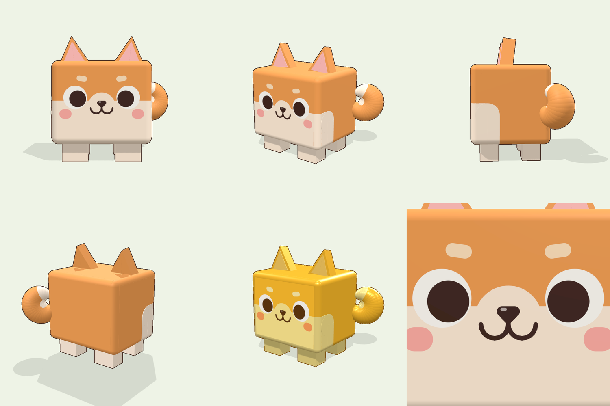

# Cube Shiba : pet Roblox (style Pet Simulator)



Modèle 3D Roblox du Shiba cubique de la planche de référence, prêt pour un jeu type Pet Simulator.
Il est fait **uniquement de pièces Roblox + une SurfaceGui pour le visage** : aucun mesh ni aucune image à uploader. Tu glisses le fichier dans Studio et c'est prêt.

| Fichier | Contenu |
|---|---|
| `CubeShiba.rbxmx` | Le pet, version normale |
| `CubeShiba_Golden.rbxmx` | Variante dorée (Golden) |
| `src/CubeShibaBuilder.luau` | Source qui génère les modèles (dimensions, couleurs, visage) |
| `tools/` | Export (Lune), vérifications, viewer 3D web |
| `preview/` | Rendus du modèle |

## Importer dans Roblox Studio

1. Glisse `CubeShiba.rbxmx` dans la fenêtre 3D de Studio, ou fais *clic droit sur ReplicatedStorage → Insert from File…*.
2. Range le modèle où ton système de pets va le chercher, par exemple `ReplicatedStorage/Pets/CubeShiba`.

## Caractéristiques

- **Corps** : cube 2,4 × 2 × 2 studs aux arêtes arrondies (dalles, cylindres et boules), dessus orange, ventre crème, taches crème sur le bas des flancs.
- **Visage** : SurfaceGui vectorielle posée directement sur la face avant (`Visual/Body/CoreFront/Face`). Elle contient le pelage, le masque crème, la bosse du museau, les sourcils clairs, les yeux (blanc + pupille noire), la truffe, la bouche « ω » et les joues roses. L'éclairage est le même que sur le reste du corps (`LightInfluence = 1`), le rendu reste net à toutes les distances, et la Gui ne contient aucune image.
- **Oreilles** : prismes triangulaires avec intérieur rose.
- **Queue** : enroulée sur le côté arrière gauche, pointe et intérieur crème.
- **Pattes** : 4 pattes « blocky » crème.
- **Contour cartoon** : `Highlight` nommé `Outline` (contour seul, remplissage transparent), comme les traits de la planche.
- **Taille** : environ 3,1 studs de haut (oreilles comprises), 78 pièces.

## Structure et rig

```
CubeShiba (Model)            PrimaryPart = RootPart, pivot au sol
├─ RootPart                  hitbox invisible, Anchored, CanQuery = true (clics / raycasts)
│  └─ RootJoint (Motor6D)  → Body
├─ Body                      os invisible du corps
│  └─ Motor6D : EarL, EarR, Tail, LegFL, LegFR, LegBL, LegBR
├─ EarL / EarR / Tail        os invisibles
├─ LegFL / LegFR / LegBL / LegBR
├─ Visual/                   toutes les pièces visibles, soudées (Weld) à leur os
│  ├─ Body/  (CoreFront porte la SurfaceGui « Face »)
│  ├─ EarL/  EarR/  Tail/
├─ Outline (Highlight)
└─ AnimationController > Animator
```

- Le pet **regarde vers -Z** (LookVector). Pour l'orienter : `pet:PivotTo(CFrame.lookAt(pos, pos + direction))`.
- Le **pivot est au sol**, sous le corps : `pet:PivotTo(CFrame.new(positionAuSol))` pose les pattes pile sur le sol.
- `L` / `R` = gauche / droite **du pet**.
- Toutes les pièces sont `CanCollide = false`, `CanTouch = false`, `Massless = true` : le pet ne gêne ni la physique ni les joueurs.
- `RootPart` est ancrée, ce qui convient aux systèmes de pets qui déplacent le modèle par `PivotTo` côté client (le cas le plus courant). Si ton système utilise la physique (`AlignPosition`…), désancre-la.
- Le rig Motor6D + `AnimationController` permet d'animer le pet avec l'Animation Editor (ou Moon Animator) si tu le souhaites.

### Exemple minimal (LocalScript)

```lua
local ReplicatedStorage = game:GetService("ReplicatedStorage")
local RunService = game:GetService("RunService")
local Players = game:GetService("Players")

local pet = ReplicatedStorage.Pets.CubeShiba:Clone()
pet.Parent = workspace

RunService.RenderStepped:Connect(function()
	local character = Players.LocalPlayer.Character
	local hrp = character and character:FindFirstChild("HumanoidRootPart")
	if not hrp then return end
	local target = hrp.CFrame * CFrame.new(3, -3, 3)          -- à côté du joueur, au niveau du sol
	local pos = pet:GetPivot().Position:Lerp(target.Position, 0.15)
	pet:PivotTo(CFrame.lookAt(pos, pos + hrp.CFrame.LookVector))
end)
```

## Personnaliser

- **Taille (pets « Huge »)** : `pet:ScaleTo(3)`. Les pièces, les joints et le visage suivent.
- **Contour** : `pet.Outline.Enabled = false` pour le retirer. Roblox n'affiche qu'environ 31 `Highlight` à la fois : si beaucoup de pets sont visibles en même temps, garde le contour seulement sur ceux du joueur local.
- **Couleurs** : chaque pièce colorée porte un attribut `Tint` (`Primary` = orange, `Secondary` = crème, `EarInner` = rose). Pour une nouvelle variante par script :

  ```lua
  for _, d in pet:GetDescendants() do
  	local tint = d:GetAttribute("Tint")
  	if tint == "Primary" then
  		if d:IsA("BasePart") then d.Color = Color3.fromRGB(90, 90, 100) else d.BackgroundColor3 = Color3.fromRGB(90, 90, 100) end
  	end
  end
  ```

  Tu peux aussi ajouter une palette dans `PALETTES` de `src/CubeShibaBuilder.luau`, puis régénérer.

## Régénérer les fichiers

Les `.rbxmx` sont générés à partir de `src/CubeShibaBuilder.luau` avec [Lune](https://lune-org.github.io/docs) :

```bash
lune run tools/build.luau            # écrit CubeShiba.rbxmx et CubeShiba_Golden.rbxmx
lune run tools/preview_export.luau   # met à jour tools/pet_data.json pour le viewer
```

`tools/build.luau` vérifie aussi automatiquement :
- que chaque `Weld` et `Motor6D` reproduit exactement la pose ;
- que toutes les pièces visibles sont soudées à un os ;
- que le fichier se relit à l'identique.

Le builder marche aussi dans Studio : mets `CubeShibaBuilder.luau` dans un ModuleScript, puis lance dans la barre de commande `require(workspace.CubeShibaBuilder).build({ variant = "Golden" }).Parent = workspace`.

**Viewer 3D** : dans `tools/`, lance `python3 -m http.server`, puis ouvre `http://localhost:8000/viewer.html`. Le viewer recrée les primitives Roblox et la SurfaceGui à partir du fichier relu, pour vérifier le modèle hors de Studio.
